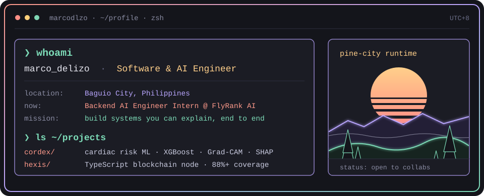

<!-- BANNER: regenerate with `python scripts/banner.py` -->
<a href="https://marcodlzo.vercel.app">
  <picture>
    <source media="(prefers-color-scheme: dark)" srcset="assets/banner-dark.svg">
    <source media="(prefers-color-scheme: light)" srcset="assets/banner-light.svg">
    
  </picture>
</a>

 

---

## `$ whoami`

  

## `$ git log --graph career`

  

 

## `$ cat tech-stack.yaml`

<table>
  <thead>
    <tr>
      <th colspan="2" align="left"><code>marcodlzo:~$ cat tech-stack.yaml</code></th>
    </tr>
  </thead>
  <tbody>
    <tr>
      <td width="50%" valign="top"><code>├─ ✦ languages:</code>  
         
        <code>TypeScript · JavaScript · Python · C / C++</code>
      </td>
      <td width="50%" valign="top"><code>├─ ◐ frontend:</code>  
         
        <code>Next.js · React · Tailwind · SFML</code>
      </td>
    </tr>
    <tr>
      <td valign="top"><code>├─ ⚙ backend_data:</code>  
         
        <code>Node.js · Express · FastAPI · PostgreSQL</code>
      </td>
      <td valign="top"><code>├─ ◉ ai_ml:</code>  
         
        <code>PyTorch · XGBoost · DenseNet121 · SHAP · Grad-CAM</code>
      </td>
    </tr>
    <tr>
      <td valign="top"><code>├─ ⌁ tooling:</code>  
         
        <code>Git · GitHub · Docker · Linux · Vercel · VS Code</code>
      </td>
      <td valign="top"><code>╰─ ◇ llm_engineering:</code>  
         
        <code>RAG pipelines · LLM APIs · Claude Code</code>
      </td>
    </tr>
    <tr>
      <td colspan="2" align="center"><code>status: available  ·  open to internships &amp; collaborations</code></td>
    </tr>
  </tbody>
</table>

---

## `$ git log --stat --since=forever`

<picture>
  <source media="(prefers-color-scheme: dark)" srcset="https://streak-stats.demolab.com/?user=marcodlzo&amp;background=14151B&amp;border=2E3040&amp;stroke=2E3040&amp;ring=FF9A8B&amp;fire=FFCF8A&amp;currStreakNum=FF9A8B&amp;sideNums=E6E6EF&amp;currStreakLabel=FFCF8A&amp;sideLabels=8A8CA3&amp;dates=6B6E88&amp;border_radius=14&amp;card_width=720&amp;timezone=Asia%2FManila">
  <source media="(prefers-color-scheme: light)" srcset="https://streak-stats.demolab.com/?user=marcodlzo&amp;background=FFF9F5&amp;border=F3D9CF&amp;stroke=F3D9CF&amp;ring=E0607A&amp;fire=FF9A8B&amp;currStreakNum=E0607A&amp;sideNums=3B2D36&amp;currStreakLabel=7A5FC9&amp;sideLabels=B39A92&amp;dates=B39A92&amp;border_radius=14&amp;card_width=720&amp;timezone=Asia%2FManila">
  
</picture>

---

## `$ ./radar --focus --langs`

<picture>
  <source media="(prefers-color-scheme: dark)" srcset="assets/radar-focus-dark.svg">
  <source media="(prefers-color-scheme: light)" srcset="assets/radar-focus-light.svg">
  
</picture>
<picture>
  <source media="(prefers-color-scheme: dark)" srcset="assets/radar-langs-dark.svg">
  <source media="(prefers-color-scheme: light)" srcset="assets/radar-langs-light.svg">
  
</picture>

<code>signals: engineering_focus · language_stack  ·  source: assets/radar.json</code>

---

## `$ connect --socials`

  

Built with ☕ and a lot of commits from Baguio City, Philippines · @marcodlzo

